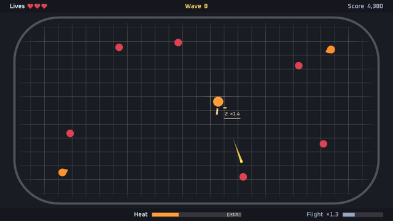

  

  <b>A 2D arcade arena game where shooting is the only way to move.</b> 
  Coming to Steam · Windows · Mac

  

## Watch

[▶ Watch the 30-second gameplay video on YouTube](https://youtu.be/Io5VK9pScDA)

## The idea

You can't walk. Every shot pushes you the other way, so aiming and moving are the same decision. Stay in the air, keep the chain going, and survive the next wave.

## Design highlights

- **Recoil is the only movement.** Every shot pushes you the other way, so each shot is an attack and a step at the same time.
- **Heat: risk and reward.** Shots fired close to overheating score ×1.5. Play it safe, or push your luck for points.
- **Waves that teach.** A new enemy type arrives alone first, with a short card, before it mixes with the others.

## My role

Game design at Tek Games, my one-person studio: core rules, difficulty curve, progression, rewards, in-game teaching and playtesting with friends.

I work with an AI coding assistant: Claude Code writes the code and tests; the design, rules, decisions and testing are mine.

## Status

In development. The Steam page opens soon.

## Contact

[LinkedIn](https://www.linkedin.com/in/kutaytekoglu/)

---

This repository only presents the project. The game's source code is private.
