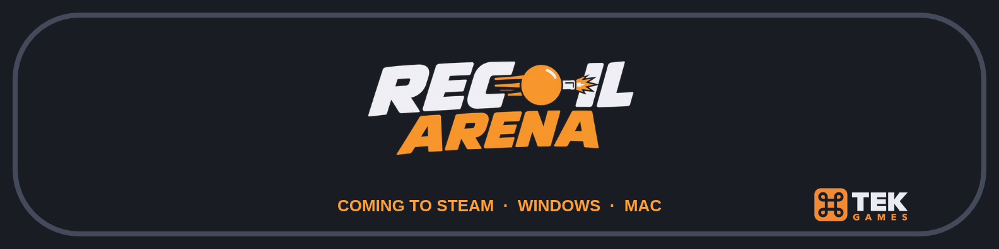

  

  <b>A 2D arcade arena game where shooting is the only way to move.</b> 
  Coming to Steam · Windows · Mac · Early Access planned for 2027

  

  <a href="https://youtu.be/Io5VK9pScDA"><b>▶ Watch the 30-second gameplay video</b></a>

## The idea

You can't walk. Every shot pushes you the other way, so aiming and moving are the same decision. A missed shot is not a mistake: it is a jump. Stay in the air, keep the chain going and survive the next wave.

## Design highlights

- **Recoil is the only movement.** Every shot is an attack and a step at the same time.
- **No punishment for missing.** Missing is how you move, so the game never takes anything away for a miss. Skill shows in where you fly, not in how little you shoot.
- **Heat: risk and reward.** Shots fired close to overheating score more. Play it safe, or push your luck.
- **Waves that teach.** A new enemy arrives alone first, with a short card, before it mixes with the others.
- **Readable chaos.** Color-blind modes, clear hit feedback and short in-game hints keep a crowded arena fair.

## How I design

1. **Rules first.** Every new feature is checked against a few fixed design rules, such as "no unfair deaths" and "nothing new without teaching it in the game".
2. **Research.** Before building something new, I study how other games solved the same problem.
3. **Prototype and playtest.** Friends play test builds on Windows and Mac and answer a short form. I change the design based on what they do, not only on what they say.
4. **Small steps.** Changes come in small groups, and each group gets its own test round.

## My role

Game design at Tek Games, my one-person studio: core rules, difficulty curve, progression, rewards, UI/UX decisions, in-game teaching and playtesting.

I work with an AI coding assistant: Claude Code writes the code and tests under my direction; the design, rules, decisions and playtests are mine.

Built with Unity 6.

## Status

- Playable test builds for Windows and Mac, played by friends.
- Next: a bigger visual and content update, the Steam page and a playable demo.

## About me

**Kutay Tekoğlu**, game designer. Final-year Digital Game Design student at Doğuş University, Istanbul. Open to internships.

[LinkedIn](https://www.linkedin.com/in/kutaytekoglu/)

---

This repository only presents the project. The game is still in development, so its source code and unreleased content (modes, enemies, balance values) stay private until release.
